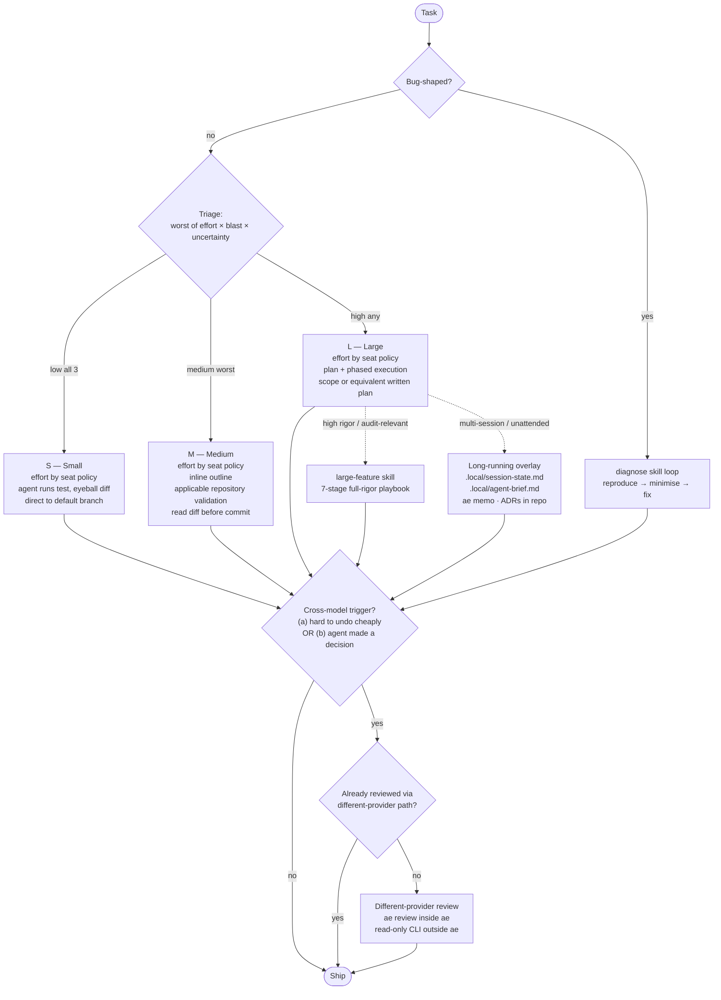

# Agentic Engineering Workflow

Operating doctrine for how to approach a task with an agent. Sibling to
`KNOWLEDGE.md` (field knowledge — what's true) and `shared/AGENTS.md` (the
contract rendered into every tool's global instruction file; it wins on
conflict). This file answers *what to do*. Source tier discipline
(`KNOWLEDGE.md` §3) applies.

---

## At a glance

Triage every task on three dimensions, take the worst. Bug-shaped work routes
through `diagnose` regardless of size. L work with high rigor reaches for the
`large-feature` skill. Cross-model review fires on its own dual-trigger,
decoupled from the bucket — and is satisfied only by a different model provider.



The rest of this file is the detail: what each bucket mandates, when triggers
fire, what counts as "different model," and the universal principles that
apply to all buckets.

---

## Triage (do this first)

Score the task on three dimensions; **take the worst**.

| Dimension | Low | Medium | High |
|---|---|---|---|
| **Effort** — reasoning load | one obvious change | normal multi-step | hard reasoning / architecture |
| **Blast radius** — cost if wrong | revert in one command | PR review catches it | prod incident or design wrong-turn |
| **Uncertainty** — can you write a one-sentence "done" definition right now without hand-waving? | yes, clean sentence | partial / some unknowns | "we'll figure out…" |

Worst dimension → bucket. **File count is not a triage criterion** — it's an outcome.

### Special triage — bug-shaped work

If the task is "something is broken / regressing / failing": route through the **`diagnose` skill** regardless of size. The structured loop (reproduce → minimise → hypothesise → instrument → fix → regression-test) prevents the guess-and-check failure mode. After `diagnose` produces a fix, re-triage the fix itself for review needs.

---

## S — Small

Obvious, low-risk work. Stay in minimal-harness mode.

**Must:**
- Agent runs the relevant test / lint / type check
- You eyeball the diff before committing

**Settings:**
- Effort: see § Effort level cheat sheet.
- Skills: none forced; the writing rules (`shared/AGENTS.md` § Writing for Clemens) are enough
- Subagents: none
- Branch: direct to the default branch is fine

**Skip:** plans, `scope`, `/code-review ultra`, cross-model — unless a trigger below fires.

---

## M — Medium

Skill-augmented single agent for the implementation; the acceptance tests come from an independent agent of a different provider, so the implementer always has a way to verify.

**Must:**
- Brief inline outline in the prompt — one paragraph: what you're doing, what done looks like, how you'll know
- Run the repository's applicable checks for this slice and checkpoint, including required lint/type checks and affected contracts. Use its focused/full risk lanes; do not interpret “validation” as every available test command. Mandatory full, freeze, release and task-specific gates remain binding. Record commands, candidate identity, results and gaps.
- You read the diff before committing
- Spec-first tests (`shared/AGENTS.md` § Engineering principles): by default one different-provider seat authors and freezes acceptance tests, then reviews implementation; test changes retain their own cross-provider review. No additional test-author seat is required.
- Independent authorship/review is not a requirement that every seat rerun every suite. The brief assigns execution and independent assessment separately; reviewers execute checks required by repository policy and investigate disputed or missing evidence. Test-author and implementation gates remain distinct; a verdict never gates itself.

**Settings:**
- Effort: see § Effort level cheat sheet.
- Skills: domain skills as needed (load from a private overlay if applicable). Consider `code-review` after implementation for non-trivial diffs.
- Subagents: `Explore` for codebase recon *only if* the change surface is unclear; the acceptance-test author is normally the pair's reviewer, not an additional seat. Authorship grants no extra write authority: a write-denied author supplies frozen test content for authorized byte-identical installation; review remains read-only.
- Branch: feature branch + PR for shared repos; direct to the default branch for personal/dotfiles

**Cross-model at M:** spec-first already makes different-provider implementation review the default — the acceptance-test author reviews the implementation (Must list above), and that pass satisfies the slice's cross-model gate. The dual-trigger rule below governs work not already reviewed (plan critique, integrated delta), not a second pass on the same implementation.

---

## L — Large

Plan-first. Phased execution.

**Must (only two):**
1. **Written plan first** — `scope` skill produces a phased plan with test gates *before* code. If `scope` feels heavy, write the equivalent to `.local/plan.md` by hand.
2. **Phased execution** — each phase ends green-or-stop. No "let me just finish this one more thing."

Plus the spec-first rule from `shared/AGENTS.md` § Engineering principles: normally the same different-provider seat authors and freezes acceptance tests, then reviews implementation; test changes retain their own cross-provider review. A separate test author may be used for parallel slices or high blast radius.

**Recommended before execution:**
- **Grill the plan** with the `grill-with-docs` skill (or a cross-model plan critique) — catches handwaves before they cost you code.
- **Break it into independently-grabbable tracer-bullet slices** if the work needs it (especially when handing off to another agent or a teammate); slice rules are in `large-feature` Stage 2.

**Use as needed (context-dependent):**
- **Subagent split** (planner / implementer / reviewer fan-out) if work parallelizes. Skip if you can hold the plan in your head.
- **Worktrees** if parallel tracks exist. Overkill for sequential phases. Own cleanup per § Git worktrees and branches below (record path/branch/owner; `git worktree remove` when no longer needed).
- **ADR** if a real design decision was made (genuine alternatives, hard to reverse, surprising without context). Rare.
- **`arch-docs` update** if the change touches the living architecture (new module, new boundary, new invariant). Not for every L task.

**Settings:**
- Effort: see § Effort level cheat sheet (`xhigh` for judgment-heavy phases).
- Branch: feature branch minimum. Worktree if you need to context-switch.
- Commits: per-phase. Each phase = revertable unit.

**Full-rigor option:** for L features that are multi-session, multi-slice, high blast radius, audit-relevant, or need a defensible handoff, see the optional **`large-feature` skill** (7-stage playbook). Invoke via `/large-feature` or *"use the large-feature playbook."* The lean two-mandate L shape above remains the default.

---

## L → Long-running mode (overlay)

When an L task spans sessions or runs unsupervised, additional patterns apply; the multi-agent `ae` workspace fits here.

**Must (additional) — repo-visible state is primary:**
- **Session-state file** in `.local/session-state.md` capturing what's done, what's in-flight, what's next. Updated at the end of each session, read at the start of the next. (`.local/` is gitignored but repo-visible.)
- **Initializer brief** in `.local/agent-brief.md` the next session reads cold. (Matt Pocock's `triage`/`AGENT-BRIEF.md` pattern is the canonical shape.)
- **Workspace handoff** via `ae memo` for shared multi-agent context (`ae memo add --topic <topic> "<fact>"`).
- **Durable decisions** as ADRs in `docs/adr/` (or repo-visible equivalents). Code, plans, and decisions all live as repo files — that's the agent's memory per `shared/AGENTS.md`.

**Optional (tool-specific mirror, not primary):**
- Claude Code auto-memory (default `<config-dir>/projects/<project>/memory/`; configurable) — Claude-only, not visible to Codex/OpenCode/Antigravity (`agy`), not versioned. Use only when (a) you're solo-on-Claude *and* (b) you want auto-memory's surfacing across unrelated sessions. Do not put anything load-bearing here that another tool would need to read.

**Recommended:**
- **`ae` multi-agent workspace** — use the session's full-path `spawn <name> --using <profile>` helper (for example `spawn reviewer --using <write-denied-profile>`, if that profile is configured); served providers must differ. Use session `ask` / `review` helpers or the `collab` skill for auditable handoffs. See the cross-model review section below for how this satisfies the contract.
- **Step back periodically** — look at the work in aggregate, check you're still on the plan. Especially after each phase merges.
- **Scheduled / unattended runs** via `/loop` (built-in to Claude Code) with an explicit max-iteration bound. Apply Ralph-loop discipline (`KNOWLEDGE.md` §17): mechanical work only, machine-verifiable completion criterion, hard iteration ceiling.

**Watch for:**
- Drift — the plan from one session may no longer match what's actually built later. Re-run `grill-with-docs` against the current state.
- Hidden state — anything load-bearing that lives in Claude Code auto-memory and another tool needs to read. Promote to `.local/` or repo file.
- Unsupervised offensive operations — never. Defensive scanning/fixing only (`KNOWLEDGE.md` §8).

---

## Cross-model review (decoupled from bucket)

`shared/AGENTS.md` requires that significant changes be reviewed by **a
different model provider** (served model, not harness) — not just by another
pane, another pass, or a specialized skill running on the same model. Workflow keeps that invariant
strict and separates "review depth" from "cross-model satisfied."

### When to trigger

Run cross-model review if **either**:

- **(a) Hard to undo cheaply** — touches `shared/AGENTS.md`, `WORKFLOW.md`, `skills/`, `KNOWLEDGE.md`, `install.conf.yaml`, `claude/settings.json` or other agent harness configs, data contracts, public APIs, deps with transitive scope, license/attribution-sensitive content, anything that changes other agents' behavior.
- **(b) Agent made a decision** rather than mechanically derived it — *"I chose X over Y because…"* in the diff or commit message signals judgment, not derivation.

One trigger fires = one cross-model pass. Both fire on an L task = two passes (plan-level + diff-level).

### What satisfies the cross-model requirement (model diversity)

Only review by a **different model provider** than the producer counts. Classify the served model, not the harness: Anthropic, OpenAI, xAI, Google, or another verified provider. OpenCode and other mutable profiles must declare their upstream provider/model before they can gate work.

- **`ae review`** signoff from an agent serving a different provider — same-provider review does not count.
- **`collab` skill signoff** from a different-provider agent in the round.
- **Prior read-only CLI review outside ae** by a different provider on the same change.

### What does NOT satisfy cross-model (but is still valuable as "review depth")

These add review depth but stay on the same model — useful, but do not waive the cross-model requirement:

- **`/code-review ultra`** (only the human starts it; it may be billed) — multi-pass review does not establish provider diversity. Follow with cross-provider review if the trigger fired and diversity is still unmet.
- **`security-review` / `gha-security-review` / Trail of Bits `fp-check`** — adds security-specific depth, same model.
- **`code-review` skill** — structured adversarial review, same model.

If you've used these, you've raised the quality bar — but you have not yet met the contract for substantial changes. Cross-model is the diversity check, these are the depth checks. Both matter, neither substitutes for the other.

### Invocation paths in this repo

Load the **`cross-model-review` skill** for routing, prompts, and artifact conventions. Inside ae, use the session's full-path `review`/`ask` helper and an eligible provider seat; never launch a reviewer CLI or internal subagent. Verify the served provider first and record it in the verdict (`gate: <provider>/<profile> PASS`).

Outside ae, reviewers use explicit read-only forms:

```bash
# Codex interactive review / analysis
codex -s read-only -a never
# Codex one-shot diff review
codex review --uncommitted -c sandbox_mode="read-only" -c approval_policy="never"
# Claude: no Bash or inherited MCP servers; give it a prepared diff artifact
claude --restricted --strict-mcp-config --disallowedTools Edit,Write,NotebookEdit
grok --sandbox read-only
muse --disable-write --disable-shell
```

Pick the provider before the harness. These permission forms do not themselves prove provider diversity.

---

## Effort level cheat sheet

| Harness / served model | Vendor default effort | Verification |
|---|---|---|
| Claude Code / Opus 5.5 | `medium` | Anthropic Opus 5.5 model page, 2026-11-07. This repo's deliberate interactive pin is `high` (`claude/settings.json` `effortLevel`, per-model `modelSettings.<id>.effortLevel`) |
| Claude Code / Fable 5.1 | `high` | Anthropic Fable 5.1 model page, 2026-11-07 |
| Claude Code / Opus 5 | `high` | `KNOWLEDGE.md` §2 table (launch notes; not re-checked 2026-11-07) |
| Codex / GPT-6.1 Sol, Terra | `low` | `codex debug models` on 0.167.0, 2026-11-07 |
| Codex / GPT-6 Sol/Luna/Astra | `medium` | `codex debug models` on 0.167.0, 2026-11-07 |
| Codex / GPT-5.6 Sol | `low` | `codex debug models` on 0.167.0, 2026-11-07 |
| Codex / GPT-5.6 Luna, Terra | `medium` | `codex debug models` on 0.167.0, 2026-11-07 |
| Grok / Grok 4.7 | not stated on the vendor pages read 2026-11-07 | repo pin `high` (`grok/config.toml` `default_reasoning_effort`) |

**Clemens' defaults:** interactive/default effort is `high`; raise to `xhigh` via `/effort` for judgment-heavy work; ae judgment seats keep `xhigh` via profile. Builders/workers start at the vendor default and change that default only on measured outcome. Effort switches preserve the prompt-prefix cache only via the API mechanism OpenAI documents (configuration_update with unchanged request-level reasoning.effort; OpenAI reasoning guide 2026-09-22) — whether Codex `/effort` uses that path is **unverified**, so treat CLI mid-thread switches as cache-risky until proven. The one-effort-per-thread rule applies to pre-GPT-6 models and, conservatively, to CLI switches generally (a comment in `codex/config.toml` records the claim, not the adoption).

For trivial mechanical work (typos, formatting, version bumps), any seat may choose `low`/`medium` per task; worker default changes still need measured outcomes, and on pre-GPT-6 models effort is still chosen only at thread start (same caution for CLI `/effort` switches on GPT-6 until the cache-preserving path is verified). Claude `max` is session-only for the single hardest L phase; only `CLAUDE_CODE_EFFORT_LEVEL` persists it.

---

## Git worktrees and branches

Read this before you create, reuse or remove a git worktree, or delete a branch. `shared/AGENTS.md` § Git keeps the binding core; this section holds the full conditions.

Git worktrees: do not pre-populate or copy `node_modules`, `.venv`, `target` or similar generated trees by default; create them only when the assigned work needs them, with the repo's setup commands and package-manager caches. Avoid recursive copies, including filesystem clones: they still create file entries and can burden endpoint security. Reuse another checkout's `node_modules` only after verifying its installed dependencies, source resolution and isolation from concurrent installs and generated/cache writes (matching manifests and lockfiles are not enough); otherwise install locally, never through a shared link. Keep Python environments worktree-local and recreate them with the repo's tool (`uv sync` for uv-managed projects) instead of copying, because scripts and editable installs can retain source/interpreter paths. Missing dependencies are setup failures, not code regressions: complete the required setup or report the verification gap.

Own cleanup of each worktree you create; record its path, branch (or detached HEAD) and cleanup owner. When no agent or process needs it any more, preserve required work and evidence, check its current state, and remove the clean worktree with `git worktree remove`; never force removal, and report any retained worktree and the reason. If you finish or hand off before cleanup is safe, report each remaining path, branch or detached HEAD, state and reason, and transfer cleanup to a named successor who accepts it; under ae, the spawner must resolve this ownership before retiring the creator.

Delete only disposable branches you or your spawned worker created for that task, using `git branch -d` after verifying their work is merged into the intended target; leave existing/shared branches alone. A rebased or squashed slice fails `git branch -d` though its work landed. Then `git branch -D` is allowed without asking when all hold, checked against the fetched remote target (`<remote-target>`, e.g. `origin/main`): never pushed, not checked out in any worktree, no merge commits (`git rev-list --merges --count <remote-target>..<branch>` is 0), and `git cherry <remote-target> <branch>` is all `-` or, for a squash, the patch-id of `git diff <merge-base> <branch>` (merge-base with `<remote-target>`) equals that of a commit on `<remote-target>`. Record branch and tip SHA in evidence. Anything else: ask.

---

## Universal principles (every bucket)

1. **Verify your work.** If the agent cannot run a check, declare the verification gap explicitly. No silent assumptions.
2. **Articulate before solving** — baked into the `diagnose` skill loop. If you cannot state the problem in one sentence, you are not ready to fix it. Reproduce → describe → then act.
3. **Clear, tight output** — `shared/AGENTS.md` § Writing for Clemens: plain STE-based prose and a visual for substantial reports to Clemens; caveman-lite between agents.
4. **Source-tier your justifications** — `KNOWLEDGE.md` §3. Tier A/B drives, C/D suggests.
5. **Effort follows seat policy** — see § Effort level cheat sheet; apply its trivial-work exception, not a blanket task-bucket override.
6. **Do not abdicate judgment.** The agent does the typing, you do the thinking. Read every diff at S/M, every phase at L.
7. **Generated code is debt until validated** — Anthropic Trends Report. Test coverage caps real throughput.
8. **Stop at done** — once the requested outcome is verified and required findings are resolved, stop. One provider-diverse review per required gate, then one focused recheck of BLOCKER/IMPORTANT fixes; no new full pass after a clean verdict. No speculative edge cases or polish past diminishing returns. Required = BLOCKER/IMPORTANT per the severity contract; NIT stays apply-if-quick.

---

## Anti-patterns

**Triage:**
- Over-triaging to L because "this might be complex" — kills throughput
- Under-triaging to S because "I know this" when uncertainty is actually high — bypasses the plan that would have saved you
- Triaging by file count or estimated time — both are downstream, not input

**Process:**
- Forcing every worker to `xhigh` without measured quality gains
- Switching effort mid-thread on pre-GPT-6 models and losing the prefix cache (GPT-6 preserves it only via the documented API mechanism; CLI behavior unverified — see cheat sheet)
- Skipping the plan at L because "I get it now" — a clear done test lowers only uncertainty; effort or blast radius can still make it L
- "Let me just finish this one more thing" mid-phase at L — abandoning the gates that made it L
- Spawning subagents on S work — overhead exceeds work
- Loading every skill into a subagent — preload cost compounds (see `manage-skills`, splitting)

**Dependencies:**
- Judging an SDK major bump by its changelog — majors silently change wire defaults. Diff them from the installed source: API version header, auth header, telemetry and trace propagation, retries, CA store. Pin the old wire in the bump where the vendor still accepts it, migrate on its own ticket, and pin the wire in a test on a captured request

**Review:**
- Skipping cross-model on dual-trigger tasks because "this one's fine"
- Treating cross-model as a rubber stamp — "LGTM, ship it" without reading findings
- Running duplicate cross-model review when a different-provider pass already happened on the same change (`ae review` / `collab` signoff from a different provider, or a prior read-only CLI pass outside ae). Note: `/code-review ultra` and same-model review skills add depth but do *not* satisfy the cross-model requirement — see the Cross-Model Review section.

**Long-running:**
- Unsupervised autonomous loops without max-iteration bounds
- Letting Claude Code auto-memory calcify with stale exploration history
- Resuming a session without reading the session-state file you wrote
- Drift: running session 5 against the plan from session 1 without re-grilling

---

## Skill cross-reference

When the bucket says "use this," reach for these:

| Bucket / case | Skills |
|---|---|
| Any bug-shaped task | `diagnose` |
| M with non-trivial diff | `code-review` after implementation |
| L planning | `scope`, then `grill-with-docs` for plan validation |
| L → break into shareable issues | `large-feature` (Stage 2 slicing) |
| L touching system structure | `arch-docs`, optionally `adr` |
| Architecture drift / should we refactor? | `refactor-audit` first (evidence + routing); then the routed structural refactor if warranted |
| Multi-agent collab + signoffs | `collab` |
| Security review | `security-review`, `gha-security-review` for workflows |
| Heavy skill files inflating subagent cost | `manage-skills` (splitting) |
| Substantial report to Clemens (structure, comparison, numbers, more than one screen) | `viz` → `references/human-report.md` |
| Agent-to-agent verbosity drift, or Clemens asks for compression | `caveman`: lite only between agents; `/caveman lite` / `full` / `ultra` for explicit human opt-in |

---

## Where this fits

- **`shared/AGENTS.md`** — the contract, rendered into every configured tool's global instruction file (security, secrets, git commit hygiene, cross-model collaboration mandate). Those installed files are **generated**: editing one is pointless, the next `./install` overwrites it. Edit `shared/AGENTS.md`.
- **`KNOWLEDGE.md`** — the field knowledge: current model table, installed-tool probes, source tiers, practitioner consensus. Older model history is in `KNOWLEDGE-CHANGELOG.md`.
- **`WORKFLOW.md`** (this file) — operating doctrine. How to actually approach a task: triage, bucket, execute.

If these three diverge, `shared/AGENTS.md` wins (it's the contract).
