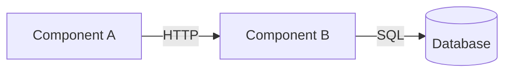

# ADR — MADR-inspired fallback template

Relocated verbatim from `SKILL.md`. Use only when Step 1 found no repo ADR template. Numbering (`0001-`) and filename (`NNNN-imperative-kebab-case-title.md`) are set in Step 1; the Rules in `SKILL.md` apply to this template as to any repo template.

## MADR-inspired fallback template

When no repo template exists, write the template below. It is *inspired by*
MADR v3.0 (https://adr.github.io/madr/) but deviates in three places, all
in service of staying lean:

1. Omits MADR's stakeholder frontmatter fields (`decision-makers`,
   `consulted`, `informed`) — usually noise in small-team / agent-driven
   contexts.
2. Splits Consequences into nested Positive/Negative buckets instead of the
   merged `Consequences` block with `Good, because` / `Bad, because` /
   `Neutral, because` lines that MADR 3.0 introduced.
3. Drops the `Pros and Cons of the Options` section entirely. It overlaps
   with `Decision Drivers` + `Decision Outcome` and is the most common
   bloat magnet — when there are 3+ options needing real comparison, add
   it back; otherwise the option names + outcome justification are enough.

If you want strict MADR fidelity, add the stakeholder fields, reshape
Consequences, and re-add the Pros and Cons section.

````markdown
---
status: Proposed
date: YYYY-MM-DD
tags:
---

# ADR-NNNN: <imperative title>

## Context and Problem Statement

<2–4 sentences. What forced this decision? What's the problem we're solving?
Reference the constraint, ticket, or incident that prompted it. Link affected
components by full path.>

## Decision Drivers

- <constraint or quality attribute, e.g. "must support 10k req/s">
- <e.g. "minimize ops surface — small team">
- <e.g. "keep migration reversible for 30 days">

## Considered Options

1. <Option A — short name>
2. <Option B — short name>
3. <Option C — short name>

## Decision Outcome

Chosen option: **<Option N>**, because <one-sentence justification anchored
to the strongest decision driver>.

### Visualization

<Required by default. Pick one diagram type that matches the decision (see
the `viz` skill for technique). Most ADRs land on a Container or Sequence
diagram. If you genuinely don't need one, replace this block with
`No diagram: <reason>` and move on.>



### Consequences

- **Positive:**
  - <what this enables / improves>
  - <what risk this avoids>
- **Negative:**
  - <what we accept as cost — be specific>
  - <what flexibility we give up>
  - <what could bite us later and under what conditions>

### Confirmation

<How will we know this decision is working? Metric, test, observation, or
"revisit if X happens".>

## More Information

- Affected components: `path/to/file.py`, `path/to/module/`
- Related ADRs: ADR-XXXX
- Related tickets: <KEY-123>
- External references: <links>
````
