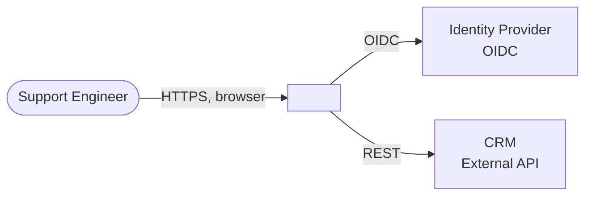
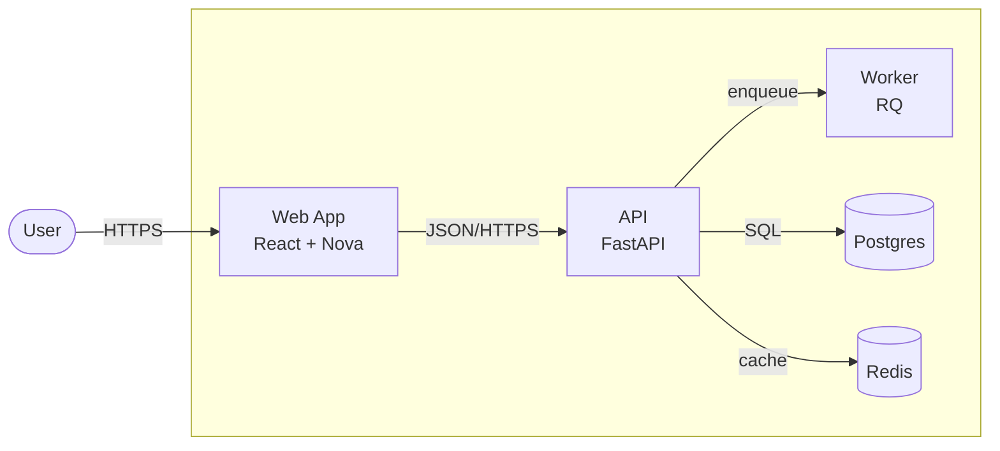
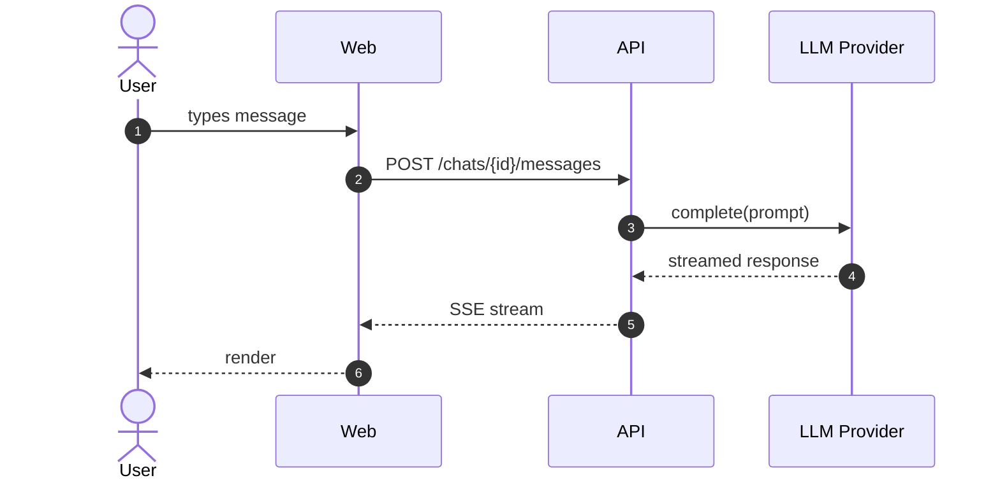
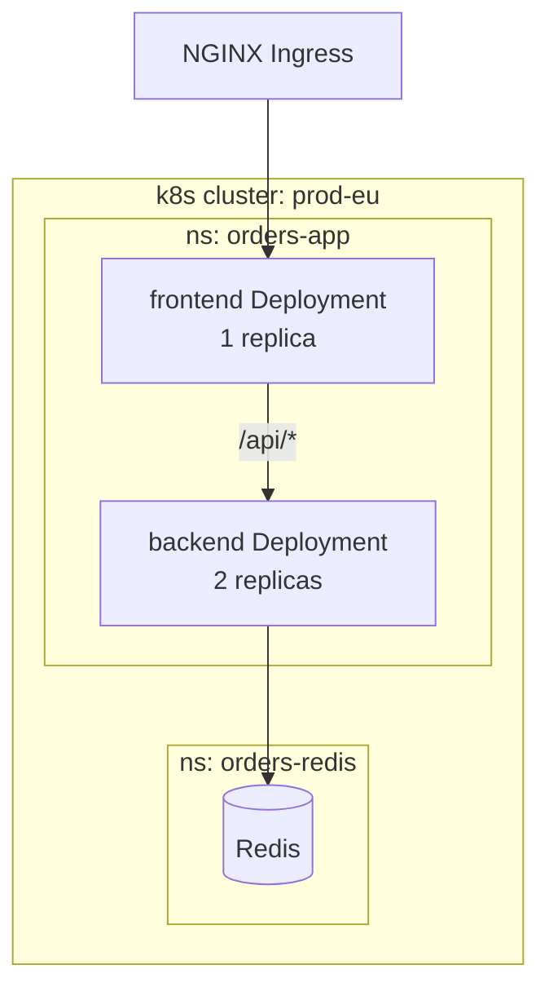
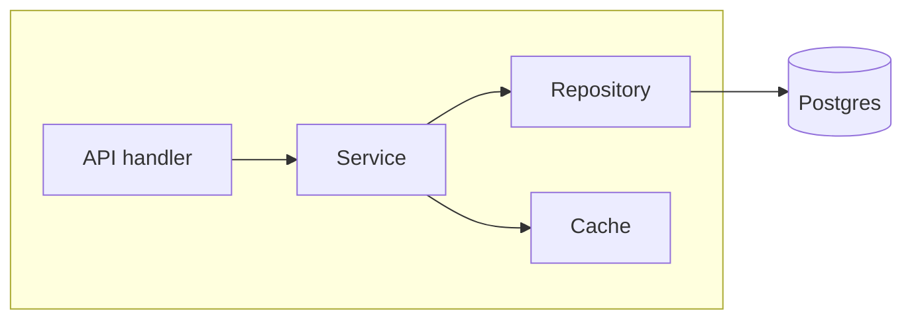

# Arch Docs — templates

Relocated verbatim from `SKILL.md`. Read before writing or restructuring an architecture doc. The size limits (overview ~200 lines / 350 hard cap, subsystem ~150 / 250, diagrams <=15 nodes, runtime scenarios <=3), the library escapes and the AI-addendum signal gate stay in `SKILL.md`.

## Overview template (`README.md` or `ARCHITECTURE.md`)

Target ~200 lines, hard cap 350. If you exceed, split into subsystem
files.

````markdown
# <System name>

> **Status:** Current — last verified <YYYY-MM-DD>

<One paragraph: what this system is, who uses it, what problem it solves.
2-4 sentences. Be specific — "order intake service for warehouse operators"
beats "generic e-commerce platform".>

## 1. Introduction & Goals

### Scope and audience

<What's in scope (this system) and out of scope (linked systems we depend
on but don't own). Who reads this doc — engineers joining the team,
operators on call, security review.>

### Architecture drivers and constraints

Top quality attributes and constraints driving the architecture. Be
specific:

- **<Driver 1>** — e.g. "p95 latency < 2s for chat responses"
- **<Driver 2>** — e.g. "auditability: every LLM call traced to user"
- **<Driver 3>** — e.g. "tenant isolation: no cross-tenant data leakage"
- **<Constraint 1>** — e.g. "must run in our k8s cluster, no external
  SaaS for primary data path"
- **<Constraint 2>** — e.g. "data residency: EU only"

### Non-goals

- <Thing we explicitly chose not to do, with one-line reason>

## 2. System Context (C4 L1)

<One paragraph framing: actors, external systems, what crosses the
boundary.>



**Library / package exception:** if the artifact is a library or SDK with
no runtime boundary, replace System Context with a "Consumer Context"
component diagram showing how consumers integrate, or write
`No L1: library package; consumers and integration points covered in
Building Blocks`.

## 3. Building Blocks (C4 L2)

<One paragraph: how the system decomposes. Reference each container by
name and one-line responsibility.>



For each container, one paragraph or bullet list:

- **<Container A>** — responsibility, key tech, where the code lives
  (full path). Owns: <data/contracts it owns>. External deps: <SDK,
  service>.
- **<Container B>** — …

If a container deserves an L3 zoom, link to its subsystem doc:
`See [<Subsystem A>](subsystems/subsystem-a.md)`.

## 4. Runtime Scenarios

2-3 critical flows. Sequence diagrams.

### <Scenario 1: e.g. "User sends a chat message">



<2-3 sentences explaining what's interesting about this flow — what's
synchronous vs streamed, where the trust boundaries are, what invariant
this protects.>

## 5. Deployment View

<One paragraph: where it runs, what runtime/cluster, what zones.>



**Skip if not applicable:** for libraries, write
`No deployment view: library distributed via PyPI/npm; consumer-deployed`.

## 6. Cross-cutting Concerns

Pick the subset that matters for this system. Don't pad — empty sections
are noise.

### Security and trust boundaries

<Auth: how requests are authenticated. Authz: how access is decided.
Mark trust boundaries on the L1/L2 diagrams when relevant. Where secrets
live and who can read them.>

### Data ownership and lifecycle

<Who owns which data. Where PII/secrets live. Retention. Backup/DR.
Cross-tenant isolation if multi-tenant.>

### Observability and operations

<Tracing/metrics/logs platforms. SLOs if defined. Failure modes and
their detection. Rollback/recovery procedure (one-line — link to runbook
for detail).>

### Error handling and resilience

<Retry/backoff policies. Circuit breakers. Idempotency contracts.
Behavior when a dependency is down.>

### Current risks and known trade-offs

This is the architecture-debt section. Be honest:

- **<Risk 1>** — what's brittle today and why
- **<Trade-off 1>** — what we accepted on purpose, with the constraint
  that forced it (link to ADR if one exists)

## Relevant decisions

<Bullet list of related ADRs. Link only — do not repeat the rationale.>

- [ADR-0007: Use Postgres for primary store](adr/0007-use-postgres.md)
- [ADR-0012: File upload pipeline](adr/0012-file-upload.md)

## Related docs

- [Invariants](invariants.md) (when present)
- [Subsystem zooms](subsystems/) (when present)
- [Operations runbook](../ops/runbook.md) (link, don't merge)

<!-- arch:watch
- src/<your-package>/**
- helm/**
- dev.config.yaml
- mcp.json
-->
````

## Subsystem template (`subsystems/<name>.md`)

Target ~150 lines, hard cap 250.

````markdown
# Subsystem: <Name>

> **Status:** Current — last verified <YYYY-MM-DD>

<One paragraph: what this subsystem owns, what bounded context it
represents, who its consumers are.>

## Responsibility

<2-4 bullets. What this subsystem is responsible for, and equally
important — what it explicitly is not.>

## Components (C4 L3)



For each component: one bullet with file path and responsibility.

## Contracts and interfaces

What the subsystem exposes to the outside. Be specific:

- **HTTP**: `POST /api/uploads`, `GET /api/uploads/{id}` —
  `src/api/routers/uploads.py`
- **Events emitted**: `upload.verified`, `upload.failed`
- **Storage owned**: `uploads` table, `attachments/` blob prefix
- **Auth boundary**: requires authenticated user + `uploads:write` role

## Local runtime scenarios

Subsystem-specific flows that don't fit at L2.

## Invariants and contracts

What must not break. e.g. "uploads are idempotent on `client_id`",
"sidecar `.md` is always written before the user-visible path returns
200".

## Current risks and known trade-offs

<Be honest about what's brittle in this subsystem.>

<!-- arch:watch
- src/<your-package>/<subsystem>/**
-->
````

## Invariants template (`invariants.md`)

Short, dense, opinionated. Things you can't grep for. Each invariant gets
3-5 lines.

```markdown
# Invariants

Repo-wide rules and gotchas that aren't obvious from reading the code.
Each entry: the rule, why it exists, where it bites if violated.

## <Invariant 1: e.g. "All timestamps are UTC and timezone-aware">

- **Rule**: every datetime emitted across an API boundary or stored in
  Redis is `datetime.now(timezone.utc)`.
- **Why**: we had a frontend bug shipping naive UTC strings as local
  time.
- **Where it bites**: `src/chat/stores.py`, anything serialized to
  Redis or sent over SSE.

## <Invariant 2: …>
```

## Optional addendum: AI systems — section skeleton

Add to the overview only when the AI-signal gate in `SKILL.md` fires.

```markdown
### AI architecture

- **Models and providers**: which models, which providers, where the
  model selection lives.
- **Prompt sources**: where system prompts come from (file, DB, agent
  config). Versioning policy.
- **Tool / MCP boundary**: which MCP servers are reachable, what
  credentials they hold. Reference the MCP config file.
- **Evaluation and guardrails**: how outputs are validated, where
  rejection logic lives.
- **Tracing and cost observability**: where traces go (Langfuse,
  OpenTelemetry), how cost is computed.
- **Data retention**: what user input is retained where, for how long.
```
