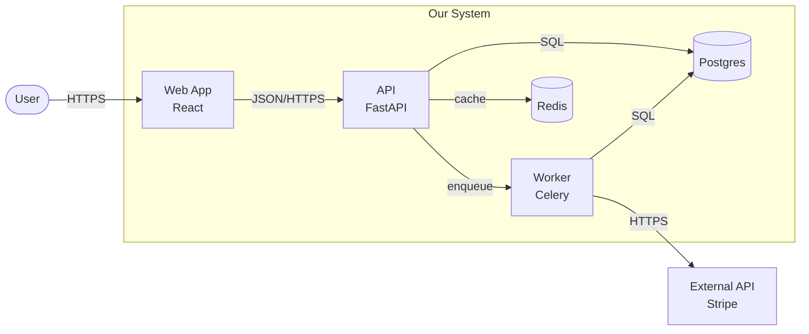
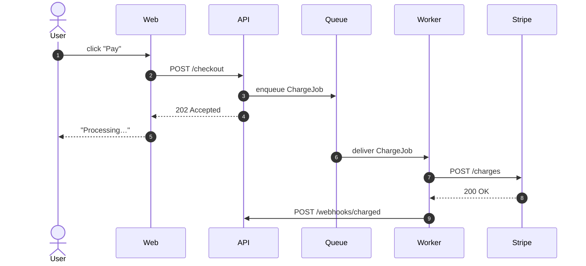
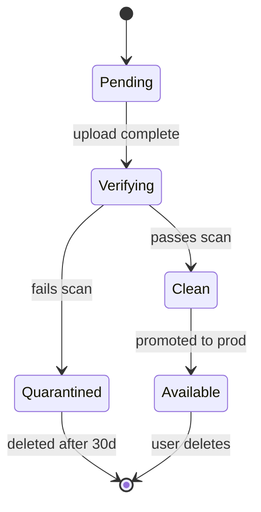
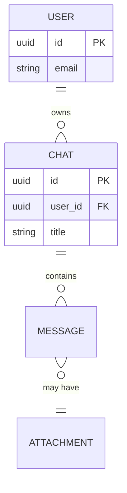
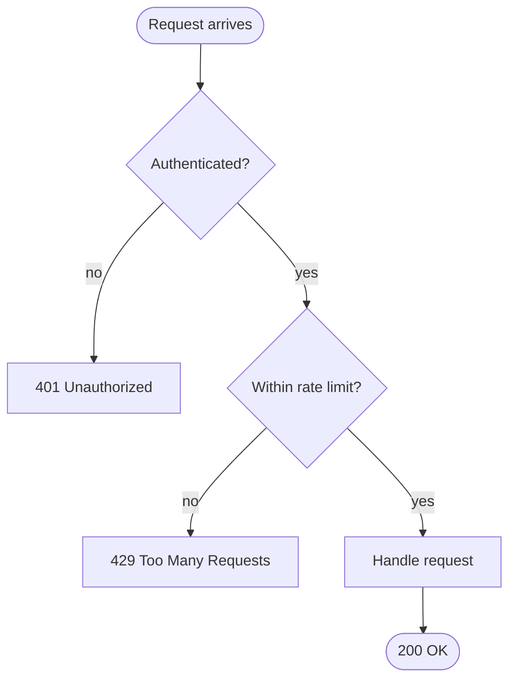
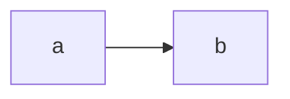

# Viz — templates and syntax reference

Relocated verbatim from `SKILL.md`. Read when you need a starting Mermaid skeleton, a syntax reminder (arrow semantics, direction modifiers) or the one-screen keyword cheat sheet. The choice-of-diagram table, C4 zoom levels, house rules and anti-patterns stay in `SKILL.md`.

## Templates

### Container diagram (C4-style, in flowchart)



Notes:
- `[]` = rectangle (service), `([])` = rounded (actor), `[()]` = cylinder
  (database), `(())` = circle
- Label edges with the protocol or intent (`HTTPS`, `enqueue`, `SQL`) — that
  detail is usually what the ADR is about
- Use `subgraph` for trust/deployment boundaries

### Sequence diagram (protocol, async flow)



Notes:
- `autonumber` makes it easy to reference steps in prose
- Arrow semantics:
  - `->>` solid: synchronous request / call
  - `-->>` dashed: response / return value
  - `-)` solid open: asynchronous send / fire-and-forget (Mermaid 9+)
  - `--)` dashed open: async response
- `actor` for humans, `participant` for systems
- Sequence diagrams do **not** use `LR`/`TD`/`BT` direction modifiers — those
  are for `flowchart` only. Layout in sequence diagrams is controlled by
  the **declaration order** of `actor`/`participant` (left-to-right).

### State diagram (lifecycle)



### ER diagram (data model)



Notes:
- `||--o{` = one-to-many. `}o--o{` = many-to-many. `||--||` = one-to-one.
- Add fields only when the schema is the point of the diagram

### Flowchart (control flow / decision)



Direction modifiers (`flowchart` only — sequence diagrams ignore these):
`TD`/`TB` (top-down), `LR` (left-right), `BT`, `RL`. For request flows in a
flowchart, prefer `LR`; for hierarchies / decision trees, prefer `TD`.

## Embedding in markdown

Mermaid blocks render automatically on GitHub, GitLab, and most modern
markdown renderers. Just use a fenced code block with `mermaid` as the
language:

````markdown

````

For local preview: VS Code has the **Markdown Preview Mermaid Support**
extension. JetBrains IDEs render it natively in markdown preview.
## Quick reference: which Mermaid block, again?

```
flowchart       → structure, control flow, C4 container/component
sequenceDiagram → time-ordered interactions
stateDiagram-v2 → state machines, lifecycles
erDiagram       → data models
classDiagram    → class hierarchies (rarely worth it)
gantt           → schedules
gitGraph        → branching strategy
journey         → user journeys
mindmap         → brainstorming (don't put in production docs)
```
